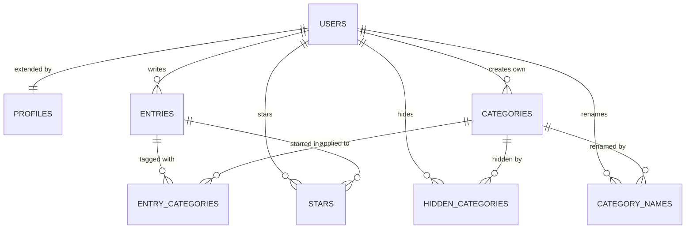

# PLAN — Jar of Light

> **This document:** 2026-11-02 (the plan itself dates from 2026-10-16, see below) · **Owner:** Boris Belyavskiy · **Coding agent:** Claude Code
> **Course:** MBA 296 Intro to Coding, Assignment F (Solo app) · **Live app:** [jaroflight.vercel.app](https://jaroflight.vercel.app)
> This is the short blueprint for the assignment. Full detail lives in the documents linked below.

**This is not the first plan: in this project the plan came first, then the code.**

- **2026-10-16: the first plan.** A master plan of the main features, in Russian, kept outside this repository. It already covered Google sign-in, entries, categories with renaming of the built-in ones, search, filters and sorting, and charts.
- **2026-10-19: the plan moves into `main`.** The [very first commit](https://github.com/boris-belyavskiy/jar-of-light/commit/081f7ad) split it into the [PRD](docs/PRD.md), [Tech Spec](docs/TECH_SPEC.md) and [Roadmap](docs/ROADMAP.md), so that product and technical information each have their own place as the app grows. The PRD header still says it was built from that plan. Everything in `main` until 2026-10-27 is documents, with no code.
- **2026-10-27: the first code.** PR #1 built the first step of that roadmap, then PRs #2–#7 continued it. Features 1–7 below come from this work.
- **2026-11-02: this file.** The assignment asks for one `PLAN.md`, so this brings the existing plan back into one document in the assignment's format. It is the same plan in a new form, not a plan written after the fact.

**What the history does not have.** The planning documents reached `main` as seven direct commits, and PRs #1–#7 had no Issues or prompt logs at the time. Changes were tried on a separate dev environment before production. I am not rewriting that history: those PRs now link to Issues marked *retroactive*, with prompts recovered from the agent's session logs. Everything from PR #9 forward follows the full loop (Issue → branch → prompt log → PR → merge → deploy), and `main` is protected so a direct commit is impossible.

---

## 1. Pitch

I'm building Jar of Light because I want more gratitude in my life, to feel included and connected, and to worry less. I'll use it every day: one entry a day.

More: [PRD §1–2](docs/PRD.md#1-summary).

## 2. Features

Numbered in build order. An *entry* (a "light") is the main item: text of 1–4,000 characters, a local date and time, and any number of categories.

| # | Type | User story | Status when this plan was written |
|---|---|---|---|
| 1 | Spine | **Sign up and login.** As a new visitor, I want to create my account with one click on "Sign in with Google", and later log in and log out, so that my journal is mine and I have no password to remember. | Live (PR #1) |
| 2 | Spine | **Data model.** As a user, I want my entries stored in my own account and linked to categories, so that I can organize them and nobody else can read them. | Live (PR #1, #6, #7) |
| 3 | Spine | **Create / read / update / delete.** As a user, I want to add an entry, see my feed, open one entry in its own window at its own link, edit it, and delete it after an "are you sure?" dialog, so that the journal stays accurate. | Live (PR #1, #5, #6) |
| 4 | Spine | **Validation.** As a user, I want a friendly message such as "Write at least a few words." when I leave the text blank or exceed 4,000 characters, in Russian or English, so that I know how to fix it. | Live (PR #1) |
| 5 | Mine | **Several categories on one entry.** As a user, I want to pick more than one category for an entry, so that a moment with my family at work counts for both. | Live (PR #1) |
| 6 | Mine | **Date and time of an entry.** As a user, I want to set the date and time of a moment (now by default, past or future allowed), so that I can record it later and still see it where it happened. | Live (PR #1, #5) |
| 7 | Mine | **Editing the built-in categories.** As a user, I want to rename or hide the built-in categories and order all of them myself, so that the list speaks my language. | Live (PR #4, #6) |
| 8 | Spine | **Find things.** As a user, I want to tick several categories with a checkbox beside each one and clear them with one "Clear" button next to the "Categories" title, search my entries by text, and sort them newest or oldest first, so that I can find one moment fast. If the categories don't fit on the screen, they scroll inside their own list. *(Three PRs: category checkboxes, search, sort.)* | Date and category filters live; the rest to build |
| 9 | Spine | **Dashboard.** As a user, I want a "Statistics" button under the category filter, always visible, that shows a bar chart of the number of entries by date and three summary stats (total lights, days with light this month, best month), for the entries my filter selects, so that I can see what my life already holds. *(Two PRs: stats, chart.)* | To build |
| 10 | Spine | **Stars.** As a user, I want to star an entry from the feed and open a "Starred" view, so that I can return to my brightest moments. *(Two PRs: stars, starred view.)* | **Undecided.** The spine requires it, but I am not sure it belongs in this product. I decide last, and nothing is built until then |

Plus two PRs for the required tests. Without stars that makes 7 PRs through the full loop after this one (5 feature PRs and 2 test PRs), on top of the 7 retroactive ones; with stars, 9.

## 3. Database

Postgres on Supabase. `auth.users` is the users table, managed by Supabase; `profiles` extends it one-to-one. Every table has Row Level Security: a row is reachable only by its owner, and the database enforces this, not the app. Full model: [Tech Spec §4](docs/TECH_SPEC.md#4-data-model).

| Table | Columns (type) | Primary key | Connects to |
|---|---|---|---|
| `auth.users` | `id` (uuid), `email` (text), managed by Supabase | `id` | Created at first sign-in |
| `profiles` | `id` (uuid), `display_name` (text), `locale` (text), `timezone` (text), `category_order` (uuid list), `created_at`, `updated_at` (timestamp) | `id` | One-to-one with `auth.users`, created by a trigger |
| `entries` | `id` (uuid), `user_id` (uuid), `body` (text), `occurred_on` (date), `occurred_time` (time), `created_at`, `updated_at` (timestamp) | `id` | Many-to-one with `auth.users` |
| `categories` | `id` (uuid), `user_id` (uuid, empty for the 6 built-in ones), `slug`, `name_ru`, `name_en` (text), `sort` (number), `created_at` (timestamp) | `id` | Many-to-one with `auth.users` |
| `entry_categories` | `entry_id`, `category_id` (uuid) | both | Junction: `entries` many-to-many `categories` |
| `hidden_categories` | `user_id`, `category_id` (uuid) | both | Junction: which built-in categories a user hid |
| `category_names` | `user_id`, `category_id` (uuid), `name_ru`, `name_en` (text) | both | A user's own names for built-in categories |
| **`stars`** (only if feature 10 is built) | `user_id`, `entry_id` (uuid), `created_at` (timestamp) | both | Junction: `auth.users` many-to-many `entries`. One table for everyone |

`STARS` in the diagram exists only if feature 10 is built. Until then the database stays as it is, with no new tables.

## 4. Tests

Both run in Vitest and in CI on every pull request.

1. **Data isolation.** Given user A has an entry, when user B signs in and reads entries, then B gets zero rows and A still gets the entry. If stars are built, the same applies to A's star. *(Runs the real migrations and RLS policies on an in-memory Postgres, PGlite.)*
2. **Dashboard.** Given a user with 5 entries, 3 in October 2026 on 2 different days and 2 in November 2026 on 2 different days, when the stats are computed for 15 November 2026, then total lights = 5, days with light this month = 2, and best month = October 2026.

## 5. Technologies

| Piece | Choice | Why |
|---|---|---|
| Coding agent | Claude Code | It works across the whole repo and handles the Git and PR flow while I review the decisions. |
| Database | Supabase Postgres (Free) | Relational data suits categories and stars, and Row Level Security enforces privacy in the database itself. |
| Sign up and login | Google button → Supabase Auth ([ADR-0002](docs/DECISIONS.md#adr-0002)) | Anyone with a Google account can join, and there are no passwords to store or to lose. |
| Hosting | Vercel (Hobby) | Free, deploys `main` automatically, and gives every PR a preview link. |
| Framework | Next.js, TypeScript | One codebase for pages and server logic, with types that catch mistakes early. |
| UI | Tailwind CSS, shadcn/ui | Accessible components themed by my own design tokens. |
| Languages | `next-intl` | The app is fully Russian and English, and my first users write in Russian. |
| Validation | Zod | One set of rules with friendly error messages, checked on the server. |
| Chart | Plain SVG, no library | One bar chart does not justify a dependency, and SVG follows the light and dark themes. |
| Tests and CI | Vitest, PGlite, GitHub Actions | They run the real database rules without a server, for free, on every PR. |

The whole stack costs $0 with no payment card ([ADR-0002](docs/DECISIONS.md#adr-0002)).

## 6. Design

"Morning sky, warm paper, small lights": warm beige background `#F4EFE6`, cream cards `#FBF8F3`, ink `#1E2A36`, sky blue `#CFE3F3` for surfaces, blue `#2F6B9A` for actions, gold `#F2C14E` only for the lights (stars, chart bars). Source Serif 4 for headings, Inter for text. Quiet, soft, mobile-first, with no confetti and no streak fireworks. The same header, column and footer on every page ([ADR-0004](docs/DECISIONS.md#adr-0004)).

Borrowing from: **Day One** (a text-first journal feed), the calm, warm interface of **Claude**, and the cosy, gentle world of the **Moomin** books by Tove Jansson. Full tokens: [Tech Spec §9](docs/TECH_SPEC.md#9-visual-design).

## 7. Risks and cuts

**Least sure about:** editing the built-in categories (feature 7). Building it was not the hard part. A user can rename "Family" into something far from its original meaning, which will make statistics by category harder in the future. It stays for now; statistics in this plan count entries by date only.

**Cut first:** text search. The spine asks for search *or* filter, plus sort, and the filters are already live.

**Open decision:** stars (feature 10). The assignment requires them as a spine feature and requires a `stars` table in `schema.md`, so leaving them out costs part of the grade. I decide at the end, and either way the result goes into Plan vs. Reality.

**Other risks:** a new table is applied to production by hand in the Supabase SQL editor, so a `stars` migration, if any, must land right before its PR merges ([supabase/README.md](supabase/README.md)). The deadline is two days away; if time runs short, working small features beat ambitious ones.

---

## Plan vs. Reality

Sections 1–7 above are the plan as merged in #9. The opening was corrected once, in #20, because it wrongly read as if the plan came after the code.

| Planned feature | Shipped / Changed / Cut | Status | What changed and why | Learning |
|---|---|---|---|---|
| 1. Sign up and login | Shipped | Done | Nothing | Google-only sign-in means a live demo sign-up needs a second Google account |
| 2. Data model | Shipped | Done | Nothing | |
| 3. Create / read / update / delete | Shipped | Done | Nothing | |
| 4. Validation | Shipped | Done | Nothing | |
| 5. Several categories on one entry | Shipped | Done | Nothing | |
| 6. Date and time of an entry | Shipped | Done | Nothing | |
| 7. Editing the built-in categories | Changed | Done | **The biggest gap.** This file lists it as live because it was written later, but the plan it was built from said built-in categories "can be hidden, but not renamed" and gave no order or second language. Real use brought renaming, dragging instead of arrows, and names in two languages (#4, #6, #7) | Using the app showed how much detail categories hold; three migrations could have been one |
| 8. Find things: checkboxes, search, sort | Shipped | Done | Search stayed even though it was first in line to be cut, because it keeps the count of feature PRs safe | Being first to cut is not the same as being cut |
| 9. Dashboard: stats | Changed | Done | "Days with light this month" became "days with an entry in the period", because I decided the period comes from the dates the user selects | A stat is a product decision: what counts as "the period" changed the test too |
| 9. Dashboard: chart | Changed | Done | Blue bars instead of gold and HTML instead of SVG, because gold has 1.63:1 contrast on the card; the agent's call and I went along | Measure the colour instead of judging it by eye |
| 10. Stars | Changed | Done | Marked undecided, then built as "Favorites" in the category filter with the star beside the "⋯" menu; I stopped the agent until it explained what stars would do | A required feature fits better once it has a name and a place that belong to the product |
| *(not planned)* Chart by category | Added | Done | I added it while building; an entry with several categories counts in each, and the page says so | Double counting is fine when it is stated |
| Test: data isolation | Shipped | Done | Nothing | The app has to be broken on purpose to prove the test can fail |
| Test: dashboard | Changed | Done | Follows the change to the stat above | |
| *(not planned)* Fixes from the stranger test | Added | Done | A first-time user found lines at the feed's edges and a bulky filter: #44 and this PR | A first-time user saw in minutes what the agent and I had missed for days |
| *(not planned)* Layout and type after the stranger test | Added | Done | I kept asking for one frame, one set of fonts and justified text, and asked to remove a shake while scrolling: #48, #50, #52, #54, #56, #58 | Small misalignments are visible to the person who uses the app every day |

**Not in the plan, and already working:** a language switch (EN / RU), dragging categories into your own order, your own categories, time zones, account deletion. See the [README](README.md#features).
