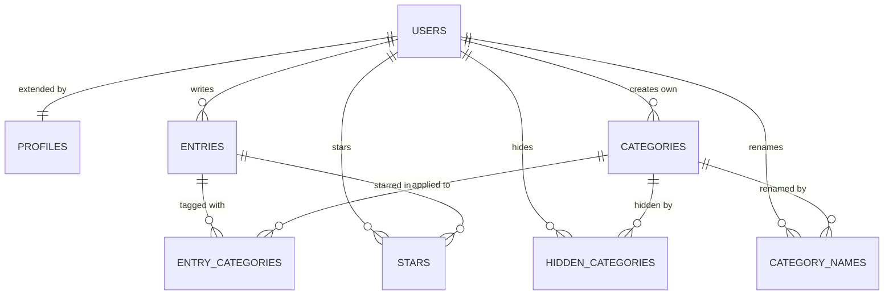

# PLAN — Jar of Light

> **Written:** 2026-11-02 · **Owner:** Boris Belyavskiy · **Coding agent:** Claude Code
> **Course:** MBA 296 Intro to Coding, Assignment F (Solo app) · **Live app:** [jaroflight.vercel.app](https://jaroflight.vercel.app)
> This is the short blueprint for the assignment. Full detail lives in the documents linked below.

**Starting point (read this first).** This repository was not empty when this file was written, and the order of events matters:

- **The plan came before the code, in other documents.** A first written plan dates from 2026-10-16. The first commit (2026-10-19) split it into the [PRD](docs/PRD.md), [Tech Spec](docs/TECH_SPEC.md), [Roadmap](docs/ROADMAP.md) and [Decisions](docs/DECISIONS.md), separate documents built for a product that will keep growing. The first code landed on 2026-10-27.
- **`PLAN.md` itself came after the code.** PRs #1–#7 (Oct 27 – Nov 1) shipped features 1–7 below, without Issues or prompt logs, and seven early documentation commits went directly to `main`. Changes were tried on a separate dev environment before production, but that is not the Issue → PR trail this assignment asks for.
- **I am not rewriting that history.** PRs #1–#7 get Issues marked *retroactive* and prompt logs recovered from the agent's session logs. Everything from this pull request forward follows the full loop (Issue → branch → prompt log → PR → merge → deploy), and `main` is now protected so a direct commit is impossible.

---

## 1. Pitch

I'm building Jar of Light because I want more gratitude in my life, to feel included and connected, and to worry less. I'll use it every day: one entry a day.

More: [PRD §1–2](docs/PRD.md#1-summary).

## 2. Features

Numbered in build order. An *entry* (a "light") is the main item: text of 1–4,000 characters, a local date and time, and any number of categories.

| # | Type | User story | Status when this plan was written |
|---|---|---|---|
| 1 | Spine | **Sign up and login.** As a new visitor, I want to create my account with one click on "Sign in with Google", and later log in and log out, so that my journal is mine and I have no password to remember. | Live (PR #1) |
| 2 | Spine | **Data model.** As a user, I want my entries stored in my own account and linked to categories, so that I can organize them and nobody else can read them. | Live (PR #1, #6, #7) |
| 3 | Spine | **Create / read / update / delete.** As a user, I want to add an entry, see my feed, open one entry in its own window at its own link, edit it, and delete it after an "are you sure?" dialog, so that the journal stays accurate. | Live (PR #1, #5, #6) |
| 4 | Spine | **Validation.** As a user, I want a friendly message such as "Write at least a few words." when I leave the text blank or exceed 4,000 characters, in Russian or English, so that I know how to fix it. | Live (PR #1) |
| 5 | Mine | **Several categories on one entry.** As a user, I want to pick more than one category for an entry, so that a moment with my family at work counts for both. | Live (PR #1) |
| 6 | Mine | **Date and time of an entry.** As a user, I want to set the date and time of a moment (now by default, past or future allowed), so that I can record it later and still see it where it happened. | Live (PR #1, #5) |
| 7 | Mine | **Editing the built-in categories.** As a user, I want to rename or hide the built-in categories and order all of them myself, so that the list speaks my language. | Live (PR #4, #6) |
| 8 | Spine | **Find things.** As a user, I want to tick several categories with a checkbox beside each one and clear them with one "Clear" button next to the "Categories" title, search my entries by text, and sort them newest or oldest first, so that I can find one moment fast. If the categories don't fit on the screen, they scroll inside their own list. *(Three PRs: category checkboxes, search, sort.)* | Date and category filters live; the rest to build |
| 9 | Spine | **Dashboard.** As a user, I want a "Statistics" button under the category filter, always visible, that shows a bar chart of the number of entries by date and three summary stats (total lights, days with light this month, best month), for the entries my filter selects, so that I can see what my life already holds. *(Two PRs: stats, chart.)* | To build |
| 10 | Spine | **Stars.** As a user, I want to star an entry from the feed and open a "Starred" view, so that I can return to my brightest moments. *(Two PRs: stars, starred view.)* | To build; last because it needs a new table on production |

Plus two PRs for the required tests. That makes 9 PRs through the full loop after this one (7 feature PRs and 2 test PRs), on top of the 7 retroactive ones.

## 3. Database

Postgres on Supabase. `auth.users` is the users table, managed by Supabase; `profiles` extends it one-to-one. Every table has Row Level Security: a row is reachable only by its owner, and the database enforces this, not the app. Full model: [Tech Spec §4](docs/TECH_SPEC.md#4-data-model).

| Table | Columns (type) | Primary key | Connects to |
|---|---|---|---|
| `auth.users` | `id` (uuid), `email` (text), managed by Supabase | `id` | Created at first sign-in |
| `profiles` | `id` (uuid), `display_name` (text), `locale` (text), `timezone` (text), `category_order` (uuid list), `created_at`, `updated_at` (timestamp) | `id` | One-to-one with `auth.users`, created by a trigger |
| `entries` | `id` (uuid), `user_id` (uuid), `body` (text), `occurred_on` (date), `occurred_time` (time), `created_at`, `updated_at` (timestamp) | `id` | Many-to-one with `auth.users` |
| `categories` | `id` (uuid), `user_id` (uuid, empty for the 6 built-in ones), `slug`, `name_ru`, `name_en` (text), `sort` (number), `created_at` (timestamp) | `id` | Many-to-one with `auth.users` |
| `entry_categories` | `entry_id`, `category_id` (uuid) | both | Junction: `entries` many-to-many `categories` |
| `hidden_categories` | `user_id`, `category_id` (uuid) | both | Junction: which built-in categories a user hid |
| `category_names` | `user_id`, `category_id` (uuid), `name_ru`, `name_en` (text) | both | A user's own names for built-in categories |
| **`stars`** (new) | `user_id`, `entry_id` (uuid), `created_at` (timestamp) | both | Junction: `auth.users` many-to-many `entries`. One table for everyone |

## 4. Tests

Both run in Vitest and in CI on every pull request.

1. **Data isolation.** Given user A has an entry and has starred it, when user B signs in and reads entries and stars, then B gets zero rows and A still gets both. *(Runs the real migrations and RLS policies on an in-memory Postgres, PGlite.)*
2. **Dashboard.** Given a user with 5 entries, 3 in October 2026 on 2 different days and 2 in November 2026 on 2 different days, when the stats are computed for 15 November 2026, then total lights = 5, days with light this month = 2, and best month = October 2026.

## 5. Technologies

| Piece | Choice | Why |
|---|---|---|
| Coding agent | Claude Code | It works across the whole repo and handles the Git and PR flow while I review the decisions. |
| Database | Supabase Postgres (Free) | Relational data suits categories and stars, and Row Level Security enforces privacy in the database itself. |
| Sign up and login | Google button → Supabase Auth ([ADR-0002](docs/DECISIONS.md#adr-0002)) | Anyone with a Google account can join, and there are no passwords to store or to lose. |
| Hosting | Vercel (Hobby) | Free, deploys `main` automatically, and gives every PR a preview link. |
| Framework | Next.js, TypeScript | One codebase for pages and server logic, with types that catch mistakes early. |
| UI | Tailwind CSS, shadcn/ui | Accessible components themed by my own design tokens. |
| Languages | `next-intl` | The app is fully Russian and English, and my first users write in Russian. |
| Validation | Zod | One set of rules with friendly error messages, checked on the server. |
| Chart | Plain SVG, no library | One bar chart does not justify a dependency, and SVG follows the light and dark themes. |
| Tests and CI | Vitest, PGlite, GitHub Actions | They run the real database rules without a server, for free, on every PR. |

The whole stack costs $0 with no payment card ([ADR-0002](docs/DECISIONS.md#adr-0002)).

## 6. Design

"Morning sky, warm paper, small lights": warm beige background `#F4EFE6`, cream cards `#FBF8F3`, ink `#1E2A36`, sky blue `#CFE3F3` for surfaces, blue `#2F6B9A` for actions, gold `#F2C14E` only for the lights (stars, chart bars). Source Serif 4 for headings, Inter for text. Quiet, soft, mobile-first, with no confetti and no streak fireworks. The same header, column and footer on every page ([ADR-0004](docs/DECISIONS.md#adr-0004)).

Borrowing from: **Day One** (a text-first journal feed), the calm, warm interface of **Claude**, and the cosy, gentle world of the **Moomin** books by Tove Jansson. Full tokens: [Tech Spec §9](docs/TECH_SPEC.md#9-visual-design).

## 7. Risks and cuts

**Least sure about:** editing the built-in categories (feature 7). Building it was not the hard part. A user can rename "Family" into something far from its original meaning, which will make statistics by category harder in the future. It stays for now; statistics in this plan count entries by date only.

**Cut first:** text search. The spine asks for search *or* filter, plus sort, and the filters are already live.

**Other risks:** a new table is applied to production by hand in the Supabase SQL editor, so the `stars` migration must land right before its PR merges ([supabase/README.md](supabase/README.md)). The deadline is two days away; if time runs short, working small features beat ambitious ones.
