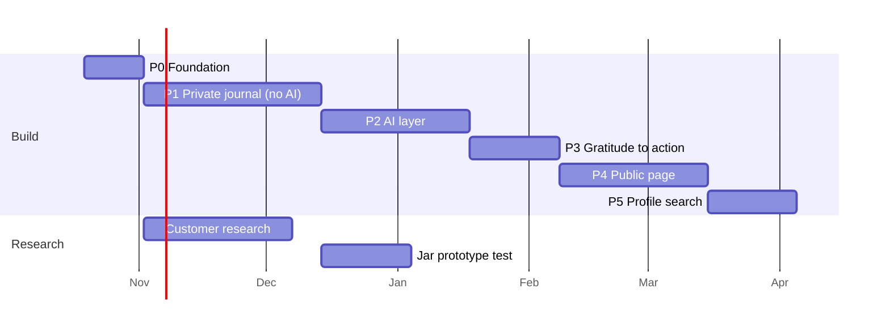

# Roadmap — Jar of Light

> **Status:** Draft v0.2 · **Updated:** 2026-10-19 · **Owner:** Boris Belyavskiy (PM)
> **Related:** [PRD](PRD.md) · [Tech Spec](TECH_SPEC.md) · [ADR log](adr/README.md)

**Logic of the sequence.** First a simple private journal **without AI**, built while doing **customer research**. Then the **AI layer**, then **gratitude → action**, then the **public page**, then **profile search**. Each phase climbs one step of the JTBD ladder (Notice → Own → Connect → Give back) and ends with a decision gate.

**Assumptions:** one builder (PM + Claude Code), ~12–15 hours a week (Q3). Windows are targets, not commitments; at full time, divide by ~2.5.

---

## Overview

| Phase | What | Target window | Release |
|---|---|---|---|
| **P0** | Foundation: repo, docs, accounts, skeleton, design tokens | Late Oct 2026 (1–2 wks) | Skeleton live on `jar-of-light.vercel.app` |
| **P1** | Private journal **without AI** + **customer research** (two parallel tracks) | Nov – mid Dec 2026 (5–6 wks) | **R1: closed beta** (10–20 people) |
| **P2** | AI layer: entry parsing, suggestions, summaries, digest | Mid Dec 2026 – mid Jan 2027 (3 wks + holiday buffer) | Beta update |
| **P3** | Gratitude → action + thank-you cards | Late Jan – early Feb 2027 (2–3 wks) | Beta update |
| **P4** | Public page: visibility levels, moderation, addressee pages | Feb – mid Mar 2027 (4–5 wks) | **R2: public beta** |
| **P5** | "Who is grateful to me?" free-text profile search | Mid Mar – early Apr 2027 (2–3 wks) | **R3** |
| Later | Reflection coach, full jar visualization, organization pages, Telegram bot, Book of the year, self-hosting review | — | — |

---

## P0 — Foundation

- [x] Public GitHub repository; PRD, Tech Spec, Roadmap, ADR-0001 *(2026-10-19)*
- [ ] Accounts: Vercel (Hobby), Supabase dev project (EU), PostHog EU, Sentry
- [ ] Next.js skeleton: TypeScript, Tailwind, shadcn/ui, `next-intl` (RU/EN), deployed to `jar-of-light.vercel.app`
- [ ] Design tokens and base layout in light and dark themes ([Tech Spec §9](TECH_SPEC.md#9-visual-design))
- [ ] Low-fi wireframes (Figma): composer (free-form / guided), feed, jar, settings
- [ ] `CLAUDE.md`, CI (lint, type check, tests), PR template
- [ ] Decide Q1–Q3 ([PRD §11](PRD.md#11-open-questions))

**Definition of Done:** the app skeleton is live from `main`; every pull request gets a preview link.

---

## P1 — Private journal without AI + customer research

Two tracks run in parallel: building the journal, and talking to users. Interviewees become the first beta users.

### Track A — Build

Requirements: ACC-01…04, ENT-01…05, CAT-01…02, HAB-01…04, CUM-01…02, DATA-01…02.

- [ ] Sign-in (email code / Google), onboarding, profile, time zone
- [ ] Free-form and guided entries; edit, delete; feed with filters and search
- [ ] People and places of my life (autocomplete from earlier entries)
- [ ] System and custom categories
- [ ] Open the jar
- [ ] Simple stats: entries per week, top people, places, categories
- [ ] Reminders: push + email on schedule (`pg_cron`)
- [ ] Export (JSON, Markdown) and account deletion
- [ ] PWA: install, icon, offline draft
- [ ] Analytics events for P1 ([Tech Spec §12](TECH_SPEC.md#12-analytics-events))
- [ ] Before inviting beta users: Supabase Pro (backups), own domain + Resend for emails, short privacy notice

**Definition of Done:** e2e tests for key scenarios (sign in → entry → feed → export → delete); RLS tests (user A cannot see user B's entries); 10–20 beta users write for at least two weeks; activation and retention dashboard in PostHog.

### Track B — Customer research

**Research questions**

1. How do S1 and S2 notice and record good things today? What have they tried, and why did they stop?
2. Which of the jobs J1–J4 resonate most, in their own words?
3. Who are they grateful to, and how often does the thanks reach that person? What gets in the way?
4. Would they share gratitude publicly? At which level (L1–L4), and what are their fears?
5. How do they react to seeing thanks addressed to their own profession (J5)?
6. Do the behavioral markers (Reddit, creators, therapist marketplaces) actually find these people?

**Method**

- [ ] Screener survey (segment, journaling history, language)
- [ ] 10–12 semi-structured interviews, 45 min, 5–6 per segment
- [ ] Competitor teardown: Presently, The Five Minute Journal, Day One, Reflectly, Rosebud ([PRD §13.2](PRD.md#132-competitors-to-review-in-p1))
- [ ] Usability test of the P1 build with 5 interviewees
- [ ] *Optional smoke test:* landing page "Say thanks to a profession" with explicit consent to publish + waitlist, to seed the public page

**Recruiting** through the behavioral markers ([PRD §3.3](PRD.md#33-behavioral-markers)): Reddit communities (following each community's rules), audiences of psychology creators, therapist-marketplace users, own network.

**Ethics:** informed consent; recordings only with permission. **Raw notes never go into this public repository**; only anonymized synthesis goes to `docs/research/`.

**Outputs:** anonymized interview synthesis, updated segments and JTBD in the PRD, beachhead decision (Q16), competitor table, 10–20 beta recruits.

---

## P2 — AI layer

Requirements: CAT-03, AI-01…04, CUM-03…05 (+ CUM-06 prototype).

- [ ] Provider abstraction, `ai_runs` logging, per-user limits, feature flag
- [ ] T1 entry parsing: prompt, Zod schema, prompt caching
- [ ] Suggestions UI for categories, people and places
- [ ] Crisis signal → support screen with help-line contacts (RU/EN)
- [ ] AI consent in onboarding; switch in settings and per entry
- [ ] T6 summaries by period, place, topic, people; weekly digest (Batch API)
- [ ] On this day
- [ ] Evals for T1 and T6 (dataset, runner, report)
- [ ] Clickable prototype of the jar visualization, tested with 5 users

**Definition of Done:** T1 and T6 pass [eval thresholds](TECH_SPEC.md#65-evals); cost per user visible in the admin panel; suggestion acceptance measured; the digest goes out on schedule in each user's time zone.

---

## P3 — Gratitude → action

Requirements: ACT-01…03, CARD-01…03.

- [ ] "Turn into action": manual path + T2 ideas and drafts with streaming
- [ ] Channels: copy, Web Share, `mailto:`, review links
- [ ] Thank-you cards: create, recipient page, revoke, "save to Thanks I received"
- [ ] Evals for T2 (rubric)

**Definition of Done:** card tokens cannot be guessed and card pages are not indexed; actions and cards are tracked through the whole funnel.

---

## P4 — Public page

Requirements: PUB-01…04, COM-01…05, MOD-01…05, DATA-03.

- [ ] Visibility levels L0–L4 and the generalization ladder in the entry UI
- [ ] Pattern checks + T3 (anonymization, private-name detection) + preview
- [ ] T4 moderation, T5 catalog matching
- [ ] Addressee catalog: ~50 professions and roles (RU/EN), admin tools
- [ ] Moderation queue, reports, limits, delayed publishing
- [ ] Public feed with actions, addressee pages, K threshold, SEO, share images
- [ ] Import consented content from the smoke test (if run)
- [ ] Privacy policy and terms; legal check (Q9)

**Definition of Done:** T3 / T4 pass eval thresholds; red-team attempts to publish a name, phone number, insult or ad do not get through; unpublishing shows on the public page within 5 minutes; Q9 closed before opening the public beta.

---

## P5 — "Who is grateful to me?"

Requirements: ID-01…04.

- [ ] Free-text self-description → T7 identities → editable chips
- [ ] Results page; "Start your jar" and "Notify me" CTAs
- [ ] Saved identities after sign-up; "You were thanked" digest
- [ ] Evals for T7

**Definition of Done:** the visitor → results → sign-up funnel is measured; identities and self-descriptions are never visible publicly (tested).

---

## Decision gates

| After | Gate | If not met |
|---|---|---|
| P1 | ≥ 10 active beta users; W2 retention ≥ 30%; research synthesized; beachhead chosen (Q16) | Iterate on the habit loop (composer, reminders, jar) before adding AI |
| P2 | T1 evals pass; AI cost ≤ $0.20 per active user; suggestion acceptance ≥ 70% | Tune prompts or models; keep AI behind a flag |
| P3 | ≥ 10% of gratitude entries lead to a completed action | Rework the action UX before opening the public layer |
| P4 | Zero personal-data leaks in red-team tests; legal check done | Do not open the public beta |

**Faster track for the portfolio** if needed: P0 → P1 → P2 (T1 only) → P3 → P4; summaries, digest and P5 afterwards. The AI and the unique public layer then appear sooner.

---

## Portfolio artifacts by phase

| Artifact | Phase | What it shows |
|---|---|---|
| PRD, Tech Spec, Roadmap, ADRs | P0 | Framing and decomposing a product |
| Interview synthesis, segments, JTBD, competitor teardown | P1 | Discovery |
| Smoke-test results (if run) | P1 | Validating demand before building |
| PostHog dashboard: activation, retention, funnels | P1+ | Data-driven product work |
| Eval reports + cost per user | P2+ | AI PM skills: quality, safety, economics |
| A/B test (e.g. reminder frequency or copy) | P2+ | Experimentation |
| Privacy and moderation model | P4 | Responsible AI and risk management |
| Launch retrospective and case study | R2 / R3 | Problem → solution → results in numbers |

---

## Later

Reflection coach (with a psychologist, [PRD §7.13](PRD.md#713-reflection-coach-later)) · full jar visualization · organization pages (B2B) · Telegram bot for reminders · Book of the year · photos and own voice transcription · revisit self-hosting ([ADR-0001](adr/0001-no-self-hosted-servers.md) triggers).
