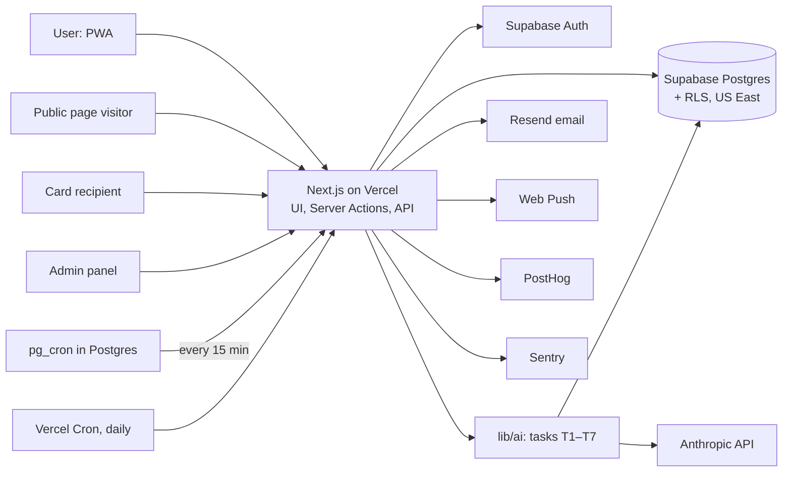
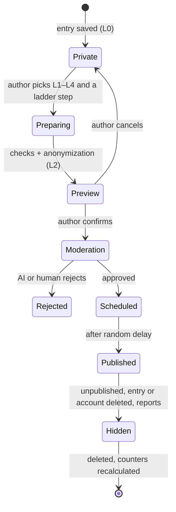

# Tech Spec — Jar of Light

> **Status:** Draft v0.3 · **Updated:** 2026-10-27 · **Owner:** Boris Belyavskiy (PM) · **Tech lead / reviewer:** Claude
> **Related:** [PRD](PRD.md) · [Roadmap](ROADMAP.md) · [Decisions](DECISIONS.md)
> Requirement IDs (ENT-01, PUB-03, …) refer to the [PRD](PRD.md#7-requirements). Phases P0–P5 refer to the [Roadmap](ROADMAP.md).

---

## Contents

1. [Scope and principles](#1-scope-and-principles)
2. [Architecture](#2-architecture)
3. [Hosting and cost by phase](#3-hosting-and-cost-by-phase)
4. [Data model](#4-data-model)
5. [Privacy model](#5-privacy-model)
6. [AI specification](#6-ai-specification)
7. [Key flows](#7-key-flows)
8. [Routes](#8-routes)
9. [Visual design](#9-visual-design)
10. [Non-functional requirements](#10-non-functional-requirements)
11. [Repository and conventions](#11-repository-and-conventions)
12. [Analytics events](#12-analytics-events)

---

## 1. Scope and principles

1. **No self-hosted servers** ([ADR-0001](DECISIONS.md#adr-0001)). Managed hosting, managed Postgres, LLM via API.
2. **Privacy by design.** Entries are private by default; Row Level Security on every user table; entry text never reaches logs, analytics or error tracking.
3. **AI behind an abstraction.** Product code calls tasks (`parseEntry`, `draftAction`, …), never a vendor SDK directly. The model can be swapped per task.
4. **Works without AI.** Every core flow has a manual path (PRD principle 7). AI features ship behind flags.
5. **Boring, portable tech.** Standard Postgres, TypeScript, open formats for export. Lock-in only where it buys a lot of speed.
6. **Start free.** P0–P1 cost $0 and need no payment card anywhere (PRD Q4, [ADR-0002](DECISIONS.md#adr-0002)); paid plans only when real users or limits require them (§3).

---

## 2. Architecture

### 2.1 Stack

| Layer | Choice | Why | Alternatives |
|---|---|---|---|
| Client | Mobile-first web app on **Next.js** (App Router), TypeScript, Tailwind CSS, shadcn/ui; **PWA** features (install, offline draft, push) in P1b | One codebase, a link to share, no app stores, web push works | Telegram Mini App, Expo / React Native |
| Server | Next.js Server Actions + Route Handlers on **Vercel** (Hobby); functions in **Cleveland (`cle1`)**, next to the database | Zero DevOps, free start, a preview deployment for every PR | Render, Fly.io, Netlify |
| Database, auth, storage | **Supabase Free**: Postgres, Row Level Security, Auth, `pg_cron`, `pg_trgm`; region **US East (Ohio)**, close to the PM and the first users (decided 2026-10-27); daily keep-alive and own nightly backups (§3.1, [ADR-0002](DECISIONS.md#adr-0002)) | Relational data and aggregates, RLS built in, portable Postgres | Neon + Better Auth, Cloudflare D1, Firebase (all compared in ADR-0002) |
| Sign-in | **Google only** (P1a): Google Identity Services button → ID token → Supabase `signInWithIdToken` | Google's dialog names our site instead of `*.supabase.co`; no passwords to store | Supabase OAuth redirect flow; email one-time codes in P1b (need a domain) |
| LLM | **Anthropic API** (`@anthropic-ai/sdk`) behind `lib/ai/provider.ts` | Quality on RU and EN, structured outputs, prompt caching, Batch API | Open-weight models via hosted inference (ADR-0001) |
| Background jobs | `after()` in Next.js for entry parsing; **Supabase `pg_cron`** for frequent schedules (reminders, retries); Vercel Cron for daily jobs; **GitHub Actions** for keep-alive and backups (§3.1) | Vercel Hobby cron runs at most once a day, so frequent jobs live in Postgres | Inngest, Trigger.dev |
| Email | Resend (+ React Email), also as SMTP for Supabase Auth; from P1b | Simple API; Supabase's built-in email is for testing only | Postmark |
| Push | Web Push (VAPID, `web-push`) | Standard and free | OneSignal |
| i18n | `next-intl`, RU + EN from day one | Portfolio in EN, first users in RU | — |
| Analytics | PostHog (cloud region chosen in P1b): events, funnels, retention, feature flags | Everything a PM needs in one place | Amplitude |
| Errors | Sentry with PII scrubbing | Standard | — |
| Tests | Vitest (unit), Playwright (e2e), own eval runner or promptfoo | — | — |
| CI/CD | GitHub + GitHub Actions + Vercel previews | — | — |
| Design | Figma (wireframes), tokens in code as the source of truth | — | — |

### 2.2 Components



### 2.3 Environments

| Environment | App | Database | Purpose |
|---|---|---|---|
| Local | `next dev` | Supabase **dev** project (or local Supabase CLI) | Development |
| Preview | Vercel preview per pull request | Supabase **dev** project | Review a change by link before merging |
| Production | Vercel production (`jaroflight.vercel.app`, own domain later) | Supabase **prod** project | Real users |

Both Supabase projects are on the Free plan (it allows two active projects).

**Google sign-in on previews.** Google does not accept wildcard origins, and every preview has its own URL, so sign-in works only locally and on production. Previews are for reviewing UI; sign-in is checked locally and on production.

Secrets live only in Vercel, Supabase and GitHub Actions settings and in a local `.env.local` that is never committed (see `.gitignore`). The project folder syncs to OneDrive, so `.env.local` holds only **dev** keys; production keys live only in Vercel.

---

## 3. Hosting and cost by phase

*Prices and limits as of 2026-10; verify before upgrading.*

| Service | P0–P1 (build + closed beta) | Later | Notes |
|---|---|---|---|
| **Vercel** | Hobby, **$0**, no card, URL `jaroflight.vercel.app` | Pro (~$20/month) once the project is commercial or outgrows limits | Hobby is for personal, non-commercial use; cron at most once a day |
| **Supabase** | Free, **$0**, no card: **dev** + **prod** projects | Pro ($25/month) only if we outgrow 500 MB or want provider backups and point-in-time restore | Free: 2 active projects, 500 MB database, 50,000 monthly active users for auth, paused after 7 days without requests, **no backups** → keep-alive and own backups (§3.1) |
| **Google Cloud** | **$0**, no billing account: one project with an OAuth client for Google sign-in | — | Sign-in is free at any number of users. Never activate the "free trial": it asks for a card and we do not need it |
| **GitHub** | Free: public code repository + private backups repository; Actions minutes within the free quota | — | — |
| **Anthropic API** | **$0** (no AI in P1) | Pay as you go, ≈ $0.10–0.15 per active user per month (§6.6) | Prepaid credits; spending limit set in the console |
| **Resend** | Not needed in P1a | Free tier from P1b if email is added | Sending to real users requires a verified own domain |
| **Domain** | Not needed | ~$10–15/year, only if we want email sign-in, reminder emails, or the app name instead of the URL in Google's sign-in dialog; needed before the public page | Until then: `jaroflight.vercel.app` |
| PostHog, Sentry | Not needed in P1a | Free tiers from P1b | — |

**Bottom line:** P0 and P1 cost **$0** and need no payment card. The first real cost is the AI layer in P2; a domain (~$1/month) is optional until the public page.

### 3.1 Keep-alive and backups

Supabase Free pauses a project after 7 days without requests and keeps no backups. We close both gaps with two scheduled GitHub Actions workflows in a **private** repository `jar-of-light-backups` (the code repository is public, so it never holds dumps or database credentials).

| Job | Schedule | What it does |
|---|---|---|
| Keep-alive | Daily | One lightweight request to the **dev** and **prod** projects, so neither ever reaches 7 idle days. A failed run emails the owner |
| Backup | Nightly | `pg_dump` of **prod** through the Session pooler connection (GitHub runners have no IPv6) → compressed → encrypted with `age` (public key in the workflow, private key kept offline by the owner) → stored as a workflow artifact with **30-day retention** |
| Restore test | Before inviting the first users, then quarterly | Restore the latest dump into **dev** and check row counts |

Data deleted by a user stays in encrypted backups for up to 30 days; the privacy note says so (PRD DATA-02, DATA-04).

---

## 4. Data model

Draft schema. All user tables have RLS: a row is visible only when `user_id = auth.uid()`.

**P1a subset.** The first build step creates only `profiles` (display name, locale, timezone), `entries` (body, `occurred_on`, `occurred_time`), `categories` and `entry_categories`. Other columns and tables arrive with their phase through new migrations. Date and time are stored as the user's **local** date and time, as entered, so the journal does not shift when the user travels; "not in the future" is checked against the profile's time zone. System categories have `user_id = NULL` and a `slug`; their RU/EN names come from the UI translations, while custom categories store `name`. Hiding a system category is stored per user.

```sql
-- Types
addressee_kind: 'close_person' | 'other_person' | 'public_figure' | 'role' | 'organization'
              | 'place' | 'work' | 'nature' | 'self' | 'abstract'
visibility:     'L0' | 'L1' | 'L2' | 'L3' | 'L4'

profiles (id uuid PK = auth.users.id, display_name, pseudonym, locale, timezone,
          ai_enabled bool DEFAULT true, default_visibility visibility DEFAULT 'L0',
          reminder jsonb,                 -- {days:[1,3,5], time:"21:00", channels:["push","email"]}
          created_at)

entries (id uuid PK, user_id FK,
         kind enum('gratitude','bright_moment'),
         mode enum('free','guided'),
         body text CHECK (length(body) BETWEEN 1 AND 4000),  -- free text, or "What happened" in guided mode
         why_it_matters text NULL,                           -- guided mode only
         occurred_on date NOT NULL, occurred_time time NOT NULL,  -- user's local date and time

         place_id FK NULL,
         intensity smallint NULL,                            -- brightness 1–5
         visibility visibility DEFAULT 'L0',
         ai_status enum('pending','done','failed','skipped'), ai_result jsonb, ai_prompt_version text,
         created_at, updated_at)

-- "People of my life": the user's private list of people, organizations, works, etc.
addressees (id PK, user_id FK, label text, kind addressee_kind NULL, relation text NULL,
            public_addressee_id FK NULL, created_at)

entry_addressees (entry_id FK ON DELETE CASCADE, addressee_id FK,
                  role enum('with','thanks_to'),      -- "who was there" / "who made it possible"
                  source enum('user','ai'), status enum('suggested','accepted','rejected'),
                  generalizations text[] NULL, chosen_level smallint NULL,
                  PRIMARY KEY (entry_id, addressee_id, role))

places (id PK, user_id FK, label text, city text NULL, created_at)   -- private; public no finer than city

categories (id uuid PK, user_id FK NULL,              -- NULL = system category
            slug, name, color, icon, is_hidden bool, sort int)
entry_categories (entry_id FK, category_id FK, source enum('user','ai'), confidence real,
                  status enum('suggested','accepted','rejected'), PRIMARY KEY (entry_id, category_id))

actions (id PK, entry_id FK ON DELETE CASCADE,
         type enum('message','letter','review','post','call','gesture','pay_forward','note'),
         draft text, channel text, status enum('suggested','opened','done','dismissed'),
         done_at, outcome_note text NULL)

gratitude_cards (id PK, entry_id FK ON DELETE CASCADE, token text UNIQUE,   -- ≥ 128 bits of randomness
                 recipient_label, message, show_author bool,
                 opened_at NULL, claimed_by uuid NULL, revoked_at NULL)

public_addressees (id PK, kind addressee_kind, slug UNIQUE, name_ru, name_en, parent_id FK NULL,
                   aliases text[], status enum('active','pending'), is_org_verified bool)

public_posts (id PK, entry_id FK ON DELETE CASCADE, public_addressee_id FK,
              level visibility CHECK (level <> 'L0'),
              text_public text NULL,          -- NULL for L1; anonymized (L2) or author's text (L3–L4)
              author_display text NULL,       -- L4 only
              action_public text NULL,        -- what the author did, if shared (COM-01)
              status enum('pending','approved','published','rejected','hidden'),
              moderation jsonb, publish_after timestamptz, published_at NULL)

reports (id PK, public_post_id FK, reporter_id NULL, reason, status, created_at)
identities (id PK, user_id FK, public_addressee_id FK, created_at)    -- private, matching only
push_subscriptions (id PK, user_id FK, endpoint, keys jsonb, created_at)
ai_runs (id PK, user_id NULL, entry_id NULL, task, model, prompt_version,
         input_tokens, output_tokens, cache_read_tokens, cost_usd numeric, latency_ms,
         status, error_code, created_at)                               -- never the entry text

-- Public statistics: only addressees thanked by ≥ K distinct authors
VIEW public_addressee_stats (public_addressee_id, authors_count, posts_count, posts_30d)
     WHERE authors_count >= 3
```

**Why `addressees` and `places` are tables, not text:** summaries "by people" and "by place" (CUM-02/03) need the same person to be one record ("Mom", "mom", "мама"). In P1 the guided form autocompletes from the user's existing records; in P2 AI suggests links for free-form entries.

---

## 5. Privacy model

### 5.1 Visibility levels: what happens technically

| Level | Name | Stored publicly | Processing before publishing | Counts toward K |
|---|---|---|---|---|
| **L0** | Only me | Nothing | — | — |
| **L1** | Count only | +1 for a `public_addressee` | Catalog matching (T5) | Yes |
| **L2** | Anonymized text | AI-anonymized text | Pattern checks + anonymization (T3) + author preview + moderation (T4) | Yes |
| **L3** | Full text, anonymous | Author's text | Pattern checks + private-name detection (T3) + preview + moderation | Yes |
| **L4** | Full text, signed | Author's text + display name | Same as L3 | Yes |
| — | Thank-you card | Card only, behind a secret link | None (the author controls the text) | — |

**Hard rules for all public levels**

- A private individual is never published by full name; at most a first name (Q14) or a role.
- Contact details (email, phone, address, URLs, @handles) are blocked by pattern checks, regardless of what AI says.
- Places are published no more precisely than the city.
- Public figures, organizations, works and discoveries may be named (with moderation).

### 5.2 Generalization ladder

T1 proposes the steps; the author chooses where to publish.

| Original | Steps (specific → general) | Publishable from |
|---|---|---|
| "My mom" | mom → **moms** → parents | "moms" |
| "Dr. Petrova at Clinic 5" | ~~Dr. Petrova~~ → clinic doctor → **doctors** → medicine | Without the name |
| "A stranger helped carry my bag" | **strangers** → kindness of strangers | Yes |
| "Wikipedia" | **Wikipedia** → online encyclopedias → knowledge | Yes (organization / work) |
| "Leo Tolstoy, *War and Peace*" | ***War and Peace*** / **Leo Tolstoy** → Russian literature | Yes (public figure / work) |

### 5.3 De-anonymization protection

1. Threshold **K ≥ 3** distinct authors before an addressee page or its anonymous texts appear (COM-03).
2. Random publication delay of 1–24 h (MOD-02).
3. Text checks: patterns + AI + mandatory author preview (PUB-03).
4. Pseudonyms are not linked to email and do not lead to a profile with other posts.
5. 100% manual pre-moderation in beta (MOD-01).

### 5.4 Publication lifecycle



### 5.5 Data protection

| Area | Measure |
|---|---|
| Access control | RLS on every user table, with automated tests ("user A cannot read user B's entries"). Service keys only on the server |
| Data location | Supabase US East (Ohio); Vercel functions in Cleveland (`cle1`). Stated in the privacy note |
| Third parties | Entry text goes only to the LLM provider, only when AI is on, only server-side. Listed in the privacy policy |
| Logs and analytics | No entry text in logs, Sentry, PostHog or `ai_runs` |
| Encryption | TLS in transit; encryption at rest by the provider. **No end-to-end encryption**: it is incompatible with AI and the public page. Mitigation: AI can be switched off per user or per entry, and then text never leaves our database |
| Retention | Account deletion removes data immediately; own encrypted backups expire within 30 days (§3.1, stated in the privacy note) |
| Secrets | Never in the repository; `.env*` is ignored; key rotation documented |

---

## 6. AI specification

### 6.1 Principles

- **All LLM calls are server-side.** Keys never reach the client.
- **Provider abstraction** (`lib/ai/provider.ts`): tasks do not know which model runs them, so models can be compared or replaced per task.
- **Structured outputs** (JSON Schema via Zod) for every parsing task; responses are validated.
- **Versioned prompts** in the repo (`prompts/T1.v3.md`); the version is stored with each result.
- **Every call is logged in `ai_runs`**: task, model, tokens, cost, latency, status. **Never the entry text.**
- **Evals before release** of each AI feature and on every prompt or model change (§6.5).
- **Per-user limits** (e.g. ≤ 50 AI calls per day) protect the budget.
- **Aggregate first, then summarize.** Summaries (T6) receive SQL aggregates plus a few selected entries, not the whole history: cheaper and less data sent.
- **Effort set explicitly per task** (`low` for parsing and moderation), since some current models default to `medium`.

### 6.2 Task registry

Models are a **starting hypothesis**; the final choice comes from evals, quality against cost (Q7).

| ID | Task | Trigger | Starting model | Mode | Output | Phase |
|---|---|---|---|---|---|---|
| **T1** | Entry parsing: kind, people and organizations (+ type, role), places, generalization ladder, categories, PII flag, crisis flag | After save | `claude-haiku-5-5` | Async | JSON (§6.4) | P2 |
| **T2** | Action ideas + message draft | "Turn into action" | `claude-sonnet-5-5` | Sync, streaming | 1–3 actions + text | P3 |
| **T3** | Anonymization (L2) and private-name / PII detection (L3–L4) | Choosing L2–L4 | `claude-sonnet-5-5` | Sync | Text + list of flagged fragments | P4 |
| **T4** | Moderation | Before the queue | `claude-haiku-5-5` | Async | Labels + scores | P4 |
| **T5** | Matching an addressee to the catalog | Publishing | `claude-haiku-5-5` + candidates from Postgres `pg_trgm` | Async | Catalog id or "new" | P4 |
| **T6** | Summaries by period, place, topic, people; weekly digest | On demand; weekly cron | `claude-sonnet-5-5`; digest via **Batch API** (−50%) | Sync / batch | Text | P2 |
| **T7** | Profile understanding: free text → identities | Profile search | `claude-haiku-5-5` + `search_catalog` tool | Sync | List of identities | P5 |
| T8 | Reflection coach | — | `claude-sonnet-5-5` / `claude-opus-5-5` | — | — | Later |

**Alternative to measure:** one model for everything (e.g. `claude-opus-5-5` at low effort). Simpler to maintain, about 3–5× more expensive (§6.6). Compared on the same evals.

**Search note:** the Anthropic API has no embeddings endpoint. Profile search (T7) starts with catalog + trigram search + LLM matching. If semantic search over texts is needed later, `pgvector` with a separate embeddings provider goes into its own ADR.

### 6.3 Taxonomies

**Addressee types (10):** close person · other person (acquaintance, stranger) · public figure · role / profession · organization · place · work / product / discovery · nature / animals · myself · abstract (life, fate, faith).

**System categories, starter set (P1a, PM decision 2026-10-27):** family · friends · work · study · health · chance encounter. Hide-only for the user (PRD CAT-01).

**Candidate extension (~15 life areas), to revisit in P2** when AI suggests categories: family · friends and relationships · work and colleagues · health and body · learning and growth · achievements · nature · home · food · culture and art · science and technology · kindness of strangers · places and travel · simple joys · meaning and spirituality.

### 6.4 T1 output schema (example)

```json
{
  "entry_kind": "gratitude",
  "language": "en",
  "addressees": [
    {
      "raw": "Olya, the nurse at the ER",
      "kind": "role",
      "role_in_entry": "thanks_to",
      "is_private_person": true,
      "generalizations": ["ER nurse", "nurses", "medicine"],
      "min_publishable_index": 0
    }
  ],
  "places": [{ "raw": "the ER on Lenin Street", "city": null }],
  "categories": [{ "id": "health", "confidence": 0.86 }],
  "suggested_new_category": null,
  "contains_pii": true,
  "safety": { "crisis_signal": false },
  "short_title": "Olya at the ER"
}
```

Input: entry text, guided fields (if any), the user's categories (id + name), the user's existing people and places (labels only, for linking), locale. The system prompt is stable and cached (prompt caching).

### 6.5 Evals

| What | Dataset | Metric | Release threshold |
|---|---|---|---|
| T1 entry kind | 200 labeled entries RU/EN (synthetic + own; **no user data without opt-in**) | Accuracy | ≥ 95% |
| T1 addressee type | Same | Accuracy | ≥ 90% |
| T1 people and places extraction | Same | Precision / recall | ≥ 90% / ≥ 85% |
| T1 categories | Same | Top-1 match | ≥ 80% (online acceptance ≥ 70%) |
| T1 crisis signal | 50 crisis + 150 regular examples | Recall | ≥ 95% (false positives acceptable) |
| **T3 anonymization / PII detection** | 150 texts with labeled personal data | PII recall | **≥ 99% + pattern checks; every miss is reviewed** |
| T4 moderation | Red-team set: insults, ads, sarcastic "thanks", personal data | Recall of harmful content | ≥ 95% |
| T2 drafts | 50 scenarios | Rubric (LLM judge + human sample): tone, language, no invented facts | ≥ 4/5 |
| T6 summaries | 30 synthetic journals | Faithfulness: no invented people, places or events | 0 hallucinated facts; rubric ≥ 4/5 |
| T7 profile → identities | 100 self-descriptions RU/EN | Precision / recall vs. labeled identities | ≥ 85% / ≥ 80% |

Process: datasets in `evals/datasets`, a runner in CI on changes to `prompts/` or models, reports in `evals/reports/` (a portfolio artifact in itself).

### 6.6 Cost estimate

**Anthropic API prices (2026-10, per 1M tokens, input / output):** Claude Haiku 5.5 — $0.10 / $0.50 (prompts up to 100K tokens) · Claude Sonnet 5.5 — $2 / $10 · Claude Opus 5.5 — $4 / $20. Batch API: −50%. Cache reads are much cheaper than regular input.

**Assumptions per active user per month:** 16 entries (T1), 4 actions (T2), 4 weekly digests (T6), 1 publication (T3 + T4). Average size: T1 — 1,500 in / 400 out; T2 — 1,200 / 1,000; T6 — 4,000 / 800; T3 — 1,000 / 500.

| Scenario | T1 | T2 | T6 | T3+T4 | **Total / user / month** | With +50% for thinking |
|---|---|---|---|---|---|---|
| **A. Mix** (Haiku for T1/T4, Sonnet for T2/T3, T6 via Batch) | $0.006 | $0.05 | $0.03 | $0.01 | **≈ $0.10** | **≈ $0.15** |
| **B. Opus 5.5 for everything** (T6 via Batch) | $0.22 | $0.10 | $0.06 | $0.02 | **≈ $0.40** | **≈ $0.60** |

| Monthly active users | 100 | 1,000 | 10,000 |
|---|---|---|---|
| Scenario A | ~$15 | ~$150 | ~$1,500 |
| Scenario B | ~$60 | ~$600 | ~$6,000 |
| Own GPU server 24/7 (rough, to verify) | $500–1,500 + DevOps | $500–1,500 + DevOps | from $1,500, needs scaling |

Conclusion and revisit triggers: [ADR-0001](DECISIONS.md#adr-0001).

---

## 7. Key flows

### 7.1 Creating an entry

1. The client keeps a local draft → Server Action `createEntry` → INSERT under RLS (entry + people + place for guided mode) → response.
2. If AI is on: `ai_status = pending`, `after()` starts T1.
3. T1 → JSON validation → suggestions for categories, people and places saved → `ai_status = done`; a row in `ai_runs`.
4. The client gets the update (Supabase Realtime or refetch) and shows suggestions.
5. On failure: `ai_status = failed`; `pg_cron` retries every 10 minutes up to 3 times, then `skipped`.

### 7.1a Sign-in (P1a)

1. The sign-in page shows the Google Identity Services button; the page origin is our domain, so Google's dialog names `jaroflight.vercel.app`.
2. Google returns an ID token → `supabase.auth.signInWithIdToken({ provider: 'google', token, nonce })` → Supabase session in cookies (`@supabase/ssr`).
3. On the first sign-in a database trigger creates `profiles` with the Google name; the client sends the browser time zone and language.
4. Signing out clears the session. Account deletion (PRD DATA-02) runs a server action with the service key: delete the auth user, and `ON DELETE CASCADE` removes the profile, entries, categories and links.

### 7.2 Reminders

`pg_cron` calls `/api/cron/reminders` every 15 minutes with a secret → the route selects users whose local reminder time falls into the window → sends push or email → logs `reminder_sent`.

### 7.3 Publishing

Author picks a level and ladder step → pattern checks → T3 (L2: anonymized text; L3–L4: flagged fragments) → preview and confirmation → T4 + T5 → moderation queue → approved → `publish_after` = now + random 1–24 h → cron publishes → stats view updates.

### 7.4 Thank-you card

Author creates a card → server generates a ≥ 128-bit token → `/card/[token]` (`noindex`) → recipient opens it (`opened_at`) → optional "save to Thanks I received" after sign-up (`claimed_by`) → author can revoke (`revoked_at`).

### 7.5 Profile search

Visitor types a self-description → T7 extracts identities with the `search_catalog` tool → editable chips → results from `public_addressee_stats` + published posts → optional sign-up saves identities (the free text itself is not stored).

---

## 8. Routes

| Route | Access | Purpose | Phase |
|---|---|---|---|
| `/` | Public | Landing with Google sign-in | P0–P1 |
| `/privacy` | Public | Short privacy note (PRD DATA-04); privacy-policy link for Google | P1a |
| `/app` | User | Feed with category filter + "new entry" | P1a |
| `/app/entry/new`, `/app/entry/[id]` | User | Create, edit, delete an entry; later AI suggestions, actions, publishing | P1a–P4 |
| `/app/categories` | User | Own categories; hide system ones | P1a |
| `/app/jar` | User | Open the jar | P1 |
| `/app/people`, `/app/places` | User | People and places of my life | P1 |
| `/app/insights` | User | Stats, summaries, on this day, digests | P1–P2 |
| `/app/settings` | User | Profile (name, time zone, language), account deletion (P1a); reminders, AI, privacy, export (later) | P1a–P2 |
| `/commons`, `/commons/[kind]/[slug]` | Public | Public page and addressee pages | P4 |
| `/who-thanks-me` | Public | Profile search | P5 |
| `/card/[token]` | By link, `noindex` | Thank-you card | P3 |
| `/admin/*` | Admin | Moderation, catalog, reports, AI metrics | P4 |
| `/api/cron/*` | Cron secret | Reminders, AI retries, digests, delayed publishing | P1+ |
| `/api/push/subscribe` | User | Push subscription | P1 |

---

## 9. Visual design

### 9.1 Concept

**Decided 2026-10-27:** option A "Morning sky" (below), chosen out of three palettes compared on real screens: A "Morning sky", B "Sage and honey", C "Dawn" ([PDFs](design/palettes/)).

**"Morning sky, warm paper, small lights."** Light blue brings calm and air; warm beige feels like a paper diary; golden accents are the "lights" you collect. The interface is quiet so the user's words stand out. Dark mode is "evening journaling": night blue with the jar glowing.

### 9.2 Color tokens

| Token | Light | Dark | Use |
|---|---|---|---|
| `--bg` | `#F4EFE6` warm beige | `#121A23` night blue | Page background |
| `--surface` | `#FBF8F3` cream | `#1A2531` | Cards, composer |
| `--surface-sunken` | `#ECE4D6` | `#0E141B` | Inputs, wells |
| `--line` | `#E2D9CB` | `#2A3746` | Borders, dividers |
| `--ink` | `#1E2A36` | `#F1EADF` | Main text |
| `--ink-muted` | `#5B6670` | `#A9B4BF` | Secondary text |
| `--sky` | `#CFE3F3` light blue | `#22374A` | Light-blue surfaces, highlights, illustration |
| `--primary` | `#2F6B9A` | `#8EC3EA` | Buttons, links, focus ring |
| `--on-primary` | `#FFFFFF` | `#121A23` | Text on primary |
| `--light` | `#F2C14E` | `#F5C96A` | The "lights": glow, jar, brightness; never body text |
| `--success` | `#2E6B4A` | `#8FD1A8` | Confirmations |
| `--danger` | `#B3473A` | `#F2A397` | Errors, destructive actions |

**Checked contrast (WCAG 2.1):** ink on bg 12.7:1 · muted on bg 5.1:1 · primary on bg 5.0:1 · white on primary 5.7:1 · ink on sky 11.1:1 · dark: ink on bg 14.7:1, primary on bg 9.3:1. All pass AA for body text.
**Rule:** light blue (`--sky`) is a surface color only; as text on beige it fails contrast (1.6:1).

### 9.3 Typography

| Role | Font | Why |
|---|---|---|
| Headings, entry titles, cards | **Source Serif 4** | Warm, bookish, diary feel |
| UI and body text | **Inter** | Highly legible on phones |

Both are open-source (SIL OFL), support Cyrillic and Latin, and are self-hosted via `next/font` (no requests to Google at runtime). Scale: 14 / 16 / 17 (entry text) / 20 / 24 / 32 px; entry text line-height 1.6.

### 9.4 Shape, space, elevation

Radii: 12 px inputs, 16 px cards, full for chips and the jar button. 4-pt spacing grid with generous whitespace. Soft shadows in the light theme; the dark theme uses surface steps instead of shadows. Mobile-first from 360 px; the composer sits within thumb reach at the bottom.

### 9.5 Components

Tailwind CSS + shadcn/ui, themed through the CSS variables above; icons from Lucide with a thin stroke. Key components: composer (bottom sheet on mobile, free-form / guided toggle), entry card, person and place chips, floating jar button ("I need some light"), visibility picker with live preview, thank-you card.

### 9.6 Motion

Saving an entry sends a small light into the jar (≤ 600 ms, ease-out). Opening the jar gently lifts one light out. `prefers-reduced-motion` turns animations into fades. No confetti, no streak fireworks.

### 9.7 Imagery

One simple line-drawn jar with glowing dots as the brand mark and empty-state illustration. No stock photos. Share images for the public page are generated from the same tokens.

### 9.8 Copy style

Sentence case, short, second person, warm. Rare exclamation marks. Errors explain what to do next. Russian and English copy are written natively, not machine-translated.

### 9.9 Brand boundaries

The warm beige is inspired by the calm interface of Claude, but the palette is our own. We do not use Anthropic brand assets (logo, fonts, accent colors).

---

## 10. Non-functional requirements

| Area | Requirement |
|---|---|
| Performance | First load ≤ 2.5 s on a mid-range phone over 4G; saving an entry feels instant (optimistic UI); T1 p95 ≤ 10 s |
| Accessibility | WCAG 2.1 AA: contrast (§9.2), keyboard, labels, `prefers-reduced-motion` |
| Security | RLS on all user tables + RLS tests; service keys server-side only; CSP; rate limits on AI endpoints, publishing and public forms; dependency scanning |
| Privacy | §5.5 |
| Reliability | Nightly encrypted backups from the first real users (§3.1); a restore test before inviting users, then quarterly |
| Localization | RU + EN; AI answers in the language of the entry; dates and times in the user's time zone |
| Cost | $0 and no payment card in P0–P1 (Q4); budget for P2 decided before AI ships; spending alerts |
| Observability | Sentry (errors), PostHog (product), `ai_runs` (AI cost, latency, failures) with an admin dashboard |

**Technical risks**

| Risk | Mitigation |
|---|---|
| Free-tier limits (Supabase pause, Vercel Hobby non-commercial, daily-only cron) | Daily keep-alive; `pg_cron` for frequent jobs; Vercel Pro if commercial |
| Data loss on Supabase Free (no provider backups) | Nightly encrypted dumps with 30-day retention and restore tests (§3.1) |
| iOS web push works only for installed PWAs | Onboarding explains "Add to Home Screen"; email as the fallback channel |
| LLM cost growth | Haiku for bulk tasks, caching, Batch, per-user limits, alerts on `ai_runs` |
| AI quality in Russian | Evals in RU and EN, model choice by data |
| Vendor lock-in | Portable Postgres, provider abstraction, open export formats |

---

## 11. Repository and conventions

```
/app                 Next.js routes (App Router)
/components          UI components
/lib/ai              provider.ts, tasks T1–T8, Zod schemas, cost tracking
/lib/db              Supabase client, queries
/prompts             versioned prompts (T1.v1.md …)
/evals               datasets/, run.ts, reports/
/supabase/migrations SQL migrations + RLS policies + seed
/docs                PRD, Tech Spec, Roadmap, ADRs, research/
CLAUDE.md            project conventions for Claude Code
```

- **Flow:** `main` is always deployable; every change goes through a pull request with a Vercel preview.
- **Commits:** Conventional Commits (`feat:`, `fix:`, `docs:` …).
- **Definition of Done for any task:** merged via PR · migrations and RLS policies · unit / e2e tests for new logic · analytics events · RU/EN strings · PRD, Tech Spec or an ADR updated if a decision changed.

---

## 12. Analytics events

Events **never contain entry text**, only metadata. Sent to PostHog.

`signup_completed`, `entry_created {kind, mode: free|guided, has_people, has_place, length_bucket, source: composer|prompt|onboarding}`, `entry_ai_processed {task, latency_ms, status}`, `category_suggestion_{accepted|rejected|edited}`, `person_suggestion_{accepted|rejected}`, `jar_opened`, `stats_viewed`, `summary_viewed {dimension: period|place|topic|people}`, `on_this_day_viewed`, `digest_opened`, `reminder_{sent|opened}`, `action_{suggested|opened|completed}`, `card_{created|opened|claimed|revoked}`, `visibility_changed {from, to}`, `public_post_{submitted|published|rejected|unpublished}`, `commons_viewed {page_type}`, `profile_search {n_identities}`, `report_submitted`, `pulse_answered {job}`, `ai_disabled`, `data_exported`, `account_deleted`.
