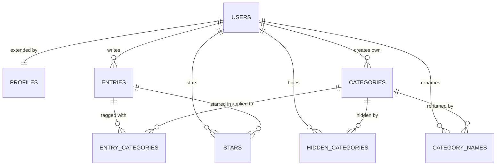

# Database schema — Jar of Light

Postgres on Supabase. This file describes what is really in the database today, taken from [supabase/migrations/](supabase/migrations/). The wider design, including tables for later phases that do not exist yet, is in [Tech Spec §4](docs/TECH_SPEC.md#4-data-model).

## How the tables relate

In plain English:

- A **user** writes many **entries**, and each entry belongs to one user.
- An **entry** can have many **categories**, and a category can be on many entries. `entry_categories` connects them.
- A **user** can star many **entries**. `stars` connects them: one table for everyone, where each row says "this user starred this entry".
- Six **built-in categories** are shared by everyone. A user can hide them (`hidden_categories`) or rename them for themselves (`category_names`) without affecting anyone else, and can also create their own.

## Tables

Every table has Row Level Security: the database itself lets a signed-in user reach only their own rows. Deleting a user removes all their rows, and deleting an entry removes its links and stars.

### `auth.users` — the users table

Managed by Supabase Auth. One row per account, created at the first Google sign-in.

| Column | Type | Notes |
|---|---|---|
| `id` | uuid | **Primary key** |
| `email` | text | From Google |

### `profiles` — one row per user

Created automatically by a database trigger at sign-up. One-to-one with `auth.users`.

| Column | Type | Notes |
|---|---|---|
| `id` | uuid | **Primary key**, references `auth.users` |
| `display_name` | text | Up to 80 characters, from Google, editable |
| `locale` | text | `ru` or `en` |
| `timezone` | text | A valid time zone name |
| `category_order` | list of uuid | The user's own order of categories |
| `created_at`, `updated_at` | timestamp | |

### `entries` — the main item

| Column | Type | Notes |
|---|---|---|
| `id` | uuid | **Primary key** |
| `user_id` | uuid | References `auth.users`; many-to-one |
| `body` | text | 1–4,000 characters, not blank |
| `occurred_on` | date | The user's local date, as entered |
| `occurred_time` | time | The user's local time, as entered |
| `created_at`, `updated_at` | timestamp | |

### `categories` — the related table

| Column | Type | Notes |
|---|---|---|
| `id` | uuid | **Primary key** |
| `user_id` | uuid | References `auth.users`; empty for the six built-in categories |
| `slug` | text | Only for built-in ones, for example `family` |
| `name_ru`, `name_en` | text | Only for a user's own categories; at least one is required |
| `sort` | number | Default order |
| `created_at` | timestamp | |

### `entry_categories` — junction: entries and categories (many-to-many)

| Column | Type | Notes |
|---|---|---|
| `entry_id` | uuid | **Primary key (both columns)**, references `entries` |
| `category_id` | uuid | **Primary key (both columns)**, references `categories` |

### `stars` — junction: users and entries (many-to-many)

| Column | Type | Notes |
|---|---|---|
| `user_id` | uuid | **Primary key (both columns)**, references `auth.users` |
| `entry_id` | uuid | **Primary key (both columns)**, references `entries` |
| `created_at` | timestamp | |

A user can star only their own entries and see only their own stars. The app calls them "Favorites".

### `hidden_categories` — which built-in categories a user hid

| Column | Type | Notes |
|---|---|---|
| `user_id` | uuid | **Primary key (both columns)**, references `auth.users` |
| `category_id` | uuid | **Primary key (both columns)**, references `categories` |

### `category_names` — a user's own names for built-in categories

| Column | Type | Notes |
|---|---|---|
| `user_id` | uuid | **Primary key (both columns)**, references `auth.users` |
| `category_id` | uuid | **Primary key (both columns)**, references `categories` |
| `name_ru`, `name_en` | text | At least one is required |

## Compared with section 3 of the plan

The agent built what the plan describes: the same eight tables, columns and relationships, including `stars` as one junction table. This is less of a test than it sounds for seven of them, because they already existed when the plan was written. The one table designed in the plan and built afterwards, `stars`, matches it column for column. The only difference is a stricter rule than the plan asked for: only `entry_id` can be set when starring, and the user always comes from the session, so nobody can star in someone else's name.
